# pkg

## File types → Level 0 tables → log sources

Each raw file type, the Level 0 tables its parsers produce (`fileparse.Parsers`), and the log sources that feed each table. A log source belongs to its file type, so the same name under two file types (e.g. `RANGEA` in NOV000 and QCPIN) is two nodes. Unparsed log sources are left out; see [fileparse/log_sources.md](fileparse/log_sources.md) for the full matrix.

```mermaid
flowchart LR
    %% File types
    NOV000[NOV000]
    NOV770[NOV770]
    DFOP00[DFOP00]
    QCPIN[QCPIN]
    AHRS00[AHRS00]
    GNSS00[GNSS00]
    TCVR00[TCVR00]
    CTD[CTD]
    SEABIRD[SEABIRD]

    %% Level 0 tables
    inspva[(inspva)]
    insstdev[(insstdev)]
    gnss_observations[(gnss_observations)]
    gnss_antenna_positions[(gnss_antenna_positions)]
    attitude_ahrs[(attitude_ahrs)]
    travel_times[(travel_times)]
    gnss_dop[(gnss_dop)]
    gnss_satellites_in_view[(gnss_satellites_in_view)]
    gnss_course_speed[(gnss_course_speed)]
    transceiver_interrogations[(transceiver_interrogations)]
    transceiver_ranges[(transceiver_ranges)]
    transceiver_settings[(transceiver_settings)]
    sound_speed[(sound_speed)]

    %% File type -> table
    NOV000 --> inspva
    NOV000 --> insstdev
    NOV000 --> gnss_observations
    NOV770 --> gnss_observations
    DFOP00 --> travel_times
    DFOP00 --> inspva
    QCPIN --> travel_times
    QCPIN --> attitude_ahrs
    QCPIN --> gnss_antenna_positions
    QCPIN --> gnss_observations
    AHRS00 --> attitude_ahrs
    GNSS00 --> gnss_antenna_positions
    GNSS00 --> gnss_dop
    GNSS00 --> gnss_satellites_in_view
    GNSS00 --> gnss_course_speed
    TCVR00 --> transceiver_interrogations
    TCVR00 --> transceiver_ranges
    TCVR00 --> transceiver_settings
    CTD --> sound_speed
    SEABIRD --> sound_speed

    %% Table -> log source (labelled file type · log source)
    inspva --> NOV000_INSPVAA([NOV000 · INSPVAA])
    insstdev --> NOV000_INSSTDEVA([NOV000 · INSSTDEVA])
    gnss_observations --> NOV000_RANGEA([NOV000 · RANGEA])
    gnss_observations --> NOV770_RANGECMPB([NOV770 · RANGECMPB])
    gnss_observations --> NOV770_RANGECMPB_1([NOV770 · RANGECMPB_1])
    gnss_observations --> NOV770_RANGECMP5B([NOV770 · RANGECMP5B])
    gnss_observations --> NOV770_RANGECMP5B_1([NOV770 · RANGECMP5B_1])
    gnss_observations --> QCPIN_RANGEA([QCPIN · RANGEA])
    travel_times --> DFOP00_INTG_RPLY([DFOP00 · INTG-RPLY])
    inspva --> DFOP00_INSPVAA([DFOP00 · INSPVAA])
    travel_times --> QCPIN_INTG_RPLY([QCPIN · INTG-RPLY])
    attitude_ahrs --> QCPIN_AHRS([QCPIN · AHRS])
    gnss_antenna_positions --> QCPIN_GNSSINS([QCPIN · GNSSINS])
    attitude_ahrs --> AHRS00_AHRS([AHRS00 · AHRS])
    gnss_antenna_positions --> GNSS00_GNSSPSEUDO([GNSS00 · GNSSPSEUDO])
    gnss_dop --> GNSS00_GSA([GNSS00 · GSA])
    gnss_satellites_in_view --> GNSS00_GSV([GNSS00 · GSV])
    gnss_course_speed --> GNSS00_VTG([GNSS00 · VTG])
    transceiver_interrogations --> TCVR00_INTERROGATE([TCVR00 · INTERROGATE])
    transceiver_ranges --> TCVR00_RANGE_RESULT([TCVR00 · RANGE_RESULT])
    transceiver_settings --> TCVR00_TCVR_CONFIG([TCVR00 · TCVR_CONFIG])
    transceiver_settings --> TCVR00_TCVR_INFO([TCVR00 · TCVR_INFO])
    sound_speed --> CTD_CTD([CTD · CTD])
    sound_speed --> SEABIRD_SEABIRD([SEABIRD · SEABIRD])
```

