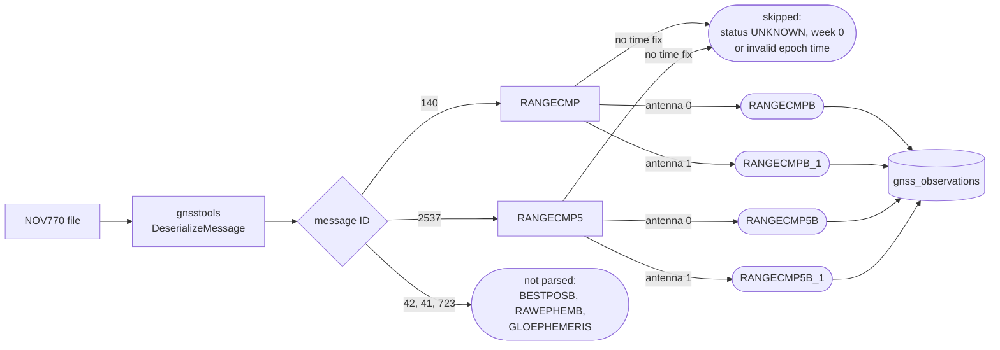

# novatel770 — RANGECMPB vs RANGECMP5B

NOV770 files (`*NOV770.raw`) hold NovAtel binary logs from a dual-antenna receiver. Two of those logs carry GNSS observations, and this package parses both into `gnss_observations`:

| Log source | Message ID | NovAtel name |
|---|---|---|
| `RANGECMPB`, `RANGECMPB_1` | 140 | RANGECMP: compressed range |
| `RANGECMP5B`, `RANGECMP5B_1` | 2537 | RANGECMP5: OEM7 compressed range |

The `_1` suffix marks the second antenna (`datamodels.LogSource`). Decoding is done by gnsstools (`codecs/novatel/novatel_binary`, `message_140.go` and `message_2537.go`); this package selects messages, drops those with no time fix, and groups epochs by log source.

Each log source is its own stream: `network.station.campaign.NOV770.<log source>`.

Both logs carry the same observations for each tracked signal: pseudorange, carrier phase, Doppler, C/N₀, lock time and std devs. They differ in how they pack them. Which one a file contains depends on how the receiver was configured; for example, SLT1 2026 has only RANGECMP5B.

Sources: the NovAtel OEM7 docs for [RANGECMP](https://docs.novatel.com/OEM7/Content/Logs/RANGECMP.htm) and [RANGECMP5](https://docs.novatel.com/OEM7/Content/Logs/RANGECMP5.htm); the gnsstools v0.117.0 decoders and `docs/message_2537_structure.md`; and a survey of two files, run on 2026-11-05 (below).

## Format

RANGECMP is an obs count followed by one fixed 24-byte record per signal. RANGECMP5 is bit-packed: a constellation bitmap, then for each system a satellite bitmap, a signal bitmap and an included-signals matrix, then for each satellite a primary signal block (115 bits) and a secondary block (86 bits) per further signal. Secondary signals are stored as differences from the satellite's primary signal.

| Field | RANGECMP (140) | RANGECMP5 (2537) |
|---|---|---|
| Pseudorange | 36 bits, 1/128 m (7.8 mm) | 37 bits, 0.5 mm. Secondary: difference from primary, 20 bits, ±262 m |
| Phase | ADR, 32 bits, 1/256 cycle. Rolls over at 2²³ cycles; the decoder rebuilds it from the pseudorange | Phase minus pseudorange, 23 bits, 0.1 mm, ±419 m |
| Doppler | 28 bits signed, 1/256 Hz | 28 bits signed, 0.1 mm/s. Secondary: difference from primary, 16 bits, 0.2 mm/s |
| C/N₀ | 5 bits, whole dB-Hz (20 + n) | 11 bits, 0.05 dB-Hz |
| Lock time | 21 bits, 1/32 s, exact. Saturates at about 18.2 h | 4-bit bucket, powers of 2 from 32 ms. The top bucket means ≥ 524 s |
| Std devs | 4 bits each | 5 bits each, exponential tables |
| Tracking status | Full 32-bit channel tracking status word | Parity and half-cycle flags only |
| GLONASS FCN | In each record | In the satellite's measurement block header |

### Lock time and cycle slips

The main thing RANGECMP5 gives up is lock time. RANGECMP's exact lock time makes a reset easy to see. With RANGECMP5 a slip only shows if the bucket goes down, so a short loss of lock inside the top bucket (≥ 524 s) can go unseen. gnsstools records a lower and upper bound (`LockTime`, `LockTimeMax`; unbounded for the top bucket), and the scanner's `LockTimeTracker` detects loss of lock from those. RANGECMP marks its saturated value as unbounded the same way.

## Survey

Both files decoded with gnsstools v0.117.0; messages with no time fix skipped.

| | 2024: `323843_001_20240313_212100_00012_NOV770.raw` | 2026: SLT1 `341517_001_20260603_175807_00046_NOV770.raw` |
|---|---|---|
| Log | RANGECMPB | RANGECMP5B |
| Antennas | 1 | 2 |
| Rate | 10 Hz | 5 Hz |
| Codes | GPS 1C/2W, GLO 1C/2P | Adds GAL 1C/7Q, BDS 2I/7I/7D, QZSS 1C/2S |
| Satellites per epoch | 10 | 28 (antenna 0), 31 (antenna 1) |
| Obs per epoch | 20 | 49, 51 |
| Payload per message | 482 B | 703 B, 736 B |
| **Bytes per observation** | **24.2** | **14.3** |
| Obs with no phase | 0 | 7% (antenna 0), 4% (antenna 1) |

RANGECMP5 takes about 40% fewer bytes per observation, with finer resolution. Rate, antenna count and constellations are receiver configuration, not format.

The files also hold other logs this package doesn't parse: BESTPOSB (42), RAWEPHEMB (41) and GLOEPHEMERIS (723). See [../log_sources.md](../log_sources.md).

## Known issues in the RANGECMP decoder

In gnsstools v0.117.0, `message_140.go`:

- **Doppler sign.** The 28-bit Doppler field is read as unsigned and never sign-extended, so every negative Doppler comes out as 1,048,576 Hz (2²⁸/256) minus its size, e.g. 1,047,526.254 Hz instead of −1,049.746 Hz. In the 2024 file this hits 196,788 of 384,290 observations (51%), and none are negative. Every RANGECMPB row already ingested has this, including those in Glue, and so does any RINEX `D` observation made from them. RANGECMP5 is unaffected (47% negative, 53% positive in the 2026 file). Pseudorange is unaffected; phase reads the ADR unsigned too, but the rollover rebuild absorbs it.
- **Unknown signals drop the rest of the epoch** (from reading the code, not seen in data). `SerializeGNSSEpoch` uses `break` rather than `continue` for an unknown signal type or system, so every record after it in that epoch is lost, not just the unknown one.
